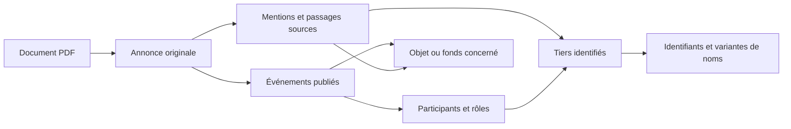

# Proposition de refonte du modèle et de l’extraction JORT

Date : 14 octobre 2026. Statut : **proposition à arbitrer, sans mise en œuvre**.

Cette analyse repose sur une lecture du code, des requêtes SQLite en lecture seule
et les documentations officielles des moteurs. La collecte et l’indexation étaient
actives pendant les observations ; les chiffres décrivent les états lus entre
17 h 25 et 17 h 33, heure Africa/Lagos, et peuvent évoluer. Aucun batch, aucune
fusion et aucune migration n’ont été déclenchés par cette analyse.

## 1. Diagnostic : ce qui existe et ce qui pose problème

L’application dispose déjà de sources conservées, de bases annuelles, d’un
référentiel global avec ID permanents, d’un historique de fusions réversibles et
d’une base de consultation paginée. Il faut conserver ces acquis.

| Observation vérifiée | Conséquence ou point à examiner |
|---|---|
| 496 272 annonces, 2 733 documents sources dans la consultation | Le précédent rapport de 196 560 annonces ne décrit plus le volume actuel. |
| 556 054 occurrences, 428 892 nœuds dans la consultation | Un nœud existant n’est pas nécessairement une identité correctement reconnue. |
| Aucun ID public manquant dans le référentiel | Les UUID et les ID `JORT-E-…` existent déjà : les préserver à la migration. |
| 48 699 annonces « à classer », soit environ 9,8 % | Distinguer l’échec de classification, un document hors périmètre et une information insuffisante. |
| 45 960 textes contiennent « convocation » | Ce mot ne suffit pas à reconnaître une convocation ; il peut figurer dans une autre annonce. |
| 768 CIN présentes dans plusieurs groupes d’identité | Candidats à consolider après contrôle de l’attribution ; ce n’est pas un décompte d’erreurs certaines. |
| 76 255 occurrences portent `identity_conflict` | Mesurer les conflits par identité et par cause, plutôt que multiplier les alertes par occurrence. |
| 47 804 occurrences de sociétés/organisations regroupées par nom présumé sans identifiant propre | Ce regroupement est plus large que la règle de présomption demandée pour les personnes. Il peut réunir des organismes distincts. |
| 189 groupes de références d’annonce répétées | Vérifier la source, la version et le passage avant toute déduplication. Une référence répétée ne justifie pas seule une suppression. |
| 116 509 liens avec une citation ; aucune date d’effet renseignée dans cette vue | Une citation existe, mais sa présence ne garantit ni le bon rôle ni le bon rattachement. La chronologie des faits reste insuffisante. |
| En 2025 : 3 745 objets « fonds de commerce », dont 771 portent ce titre générique ; 2 048 annonces ont des liens de vente | L’objet peut être identifié ou titré alors que les parties ne sont pas reconnues. Il faut des états distincts pour ces résultats. |
| Consultation : environ 4 356 Mio ; référentiel : 536 Mio ; export JSON : 1 124 Mio | La duplication du texte et les reconstructions globales restent coûteuses. La taille seule ne mesure pas la performance. |
| En 2025, les tables préparatoires `identity_records`, `identity_occurrences`, `identity_candidates` et `processing_jobs` sont vides | Une structure future existe à côté du système réellement utilisé : choisir une seule architecture, éviter deux systèmes d’identité concurrents. |

### Causes visibles dans le code

1. **Catégories mélangées.** `societe`, `association`, `organisation` décrivent
   un tiers ; `fonds_commerce` décrit un objet ; `a_classer` décrit un état de
   traitement. Aucun axe indépendant ne distingue réellement convocation,
   constitution, nomination ou cession.
2. **Découpage fragile en amont.** L’importeur découpe le texte assemblé aux
   références finales. Il indique lui-même que l’ordre des colonnes et les limites
   des annonces ne sont pas garantis. Des règles supplémentaires sur un texte mal
   segmenté peuvent fabriquer des entités incohérentes.
3. **Mentions et identités trop liées.** Une occurrence est souvent créée en
   même temps qu’un rôle reconnu. Une personne nommée sans rôle couvert par les
   expressions régulières peut manquer. À l’inverse, un en-tête peut passer pour
   un nom.
4. **Identifiants insuffisamment structurés.** Une occurrence a essentiellement
   un champ `identifier` et un type. La recherche d’un identifiant peut parcourir
   jusqu’à 700 caractères après un nom, sans frontière explicite entre tiers.
   Cela présente un risque d’attribution à la mauvaise entité. MF, IU et RC ne
   doivent pas être rendus équivalents par simple ressemblance.
5. **Cas de vente trop restreints.** Le parseur choisit généralement un acheteur
   et un vendeur, avec un complément spécifique pour un second vendeur. Les
   listes de parties, indivisions et représentants demandent un modèle général.
6. **Temporalité limitée.** Le code reconnaît surtout les dates introduites par
   « à compter du », « prend effet » et équivalents. La date de l’assemblée, du
   procès-verbal, de l’acte et de l’enregistrement reste à structurer séparément.
7. **Recherche coûteuse sur mots courants.** La sélection commence par un OU
   entre les mots, puis calcule le classement en Python dans SQLite sur les
   candidats, pour le total et pour le tri. Le précédent rapport mesurait jusqu’à
   7,6 s pour une recherche à plusieurs mots ; ce n’est pas un benchmark du corpus
   actuel. Le problème porte aussi sur le nombre de candidats traités.
8. **Publication encore globale.** L’agrégateur relit les JSON annuels et écrit
   un export global. L’index de consultation sait limiter la réindexation du texte
   aux années modifiées, mais réconcilie encore globalement nœuds et liens.

Un exemple désormais correct doit être conservé comme référence :
`2012G07567SANB2`, HELIOFLEX North Africa S.P.S, contient la société principale,
sept administrateurs personnes/sociétés, le nouvel administrateur, le commissaire
aux comptes, puis les renouvellements du président et du directeur général.
L’extraction actuelle restitue ces onze faits de rôle. La refonte doit préserver
ce résultat, enrichir ses dates et éviter d’en déduire une situation actuelle.

### Cas complémentaire : ONE TECH BUSINESS SOLUTIONS

L’annonce `2017401317SANB2` a été retrouvée en lecture seule dans la base 2017
et dans la base de consultation. Son texte et son titre sont présents ; son état
d’indexation est `terminee`. Pourtant, elle ne possède qu’une occurrence de la
société principale et **aucune relation**. Une nouvelle lecture du texte par le
parseur actuel, uniquement en mémoire, ne reconnaît toujours aucune personne.
Le problème dépasse donc un simple retard de publication ou de rafraîchissement.

L’acte décrit notamment :

- la nomination de **Khaled Abdeljaoued**, directeur général de **ONE TECH
  BUSINESS SOLUTIONS** ;
- le renouvellement des fonctions de **Hedi Karim Sellami**, cité comme
  représentant de **One Tech Holding**, en qualité d’administrateur délégué.

Le parseur de nomination ne couvre pas correctement la construction « en qualité
de Directeur Général » : le motif actuel prévoit `d` et son apostrophe éventuelle,
mais pas la forme complète `de`. Il faut couvrir les formulations usuelles et les
sauts de ligne, avec des limites de clause, plutôt que multiplier des motifs
spécifiques à un nom. Le passage insérant « représentant de la société… » demande
en outre une extraction distincte de la personne, de l’organisation représentée
et du rôle. One Tech Holding et One Tech Business Solutions restent deux tiers
distincts ; leur proximité de nom n’autorise pas une fusion.

La requête de recherche d’entités sur l’expression exacte `ONE TECH BUSINESS
SOLUTIONS` trouve **20 fiches** dans l’état observé. Plusieurs ont pour nom
« Messieurs les actionnaires de la Société… » ou un préfixe « CNSS… », et plusieurs
n’ont aucune relation. Ce nombre décrit des résultats techniques, pas vingt
sociétés distinctes ni vingt doublons dont la fusion serait déjà certaine.
Le code du réseau choisit par défaut le premier résultat ; un tel choix peut
afficher un réseau vide alors que d’autres fiches possèdent des connexions.
L’absence de tout résultat rapportée dans l’interface n’est donc pas reproduite
au niveau de cette requête : l’état des filtres et le parcours visuel restent
à contrôler lors de la phase de restitution.

Ce cas ajoute les exigences suivantes aux lots proposés :

1. **Reconnaissance indépendante des personnes et de leurs rôles.** Extraire la
   mention même si la relation n’a pas encore été résolue, sans inventer de rôle.
2. **Nettoyage des noms et variantes documentées.** Séparer dénomination,
   civilité, en-tête de convocation et numéro administratif ; conserver le texte
   d’origine. Utiliser les identifiants correctement attribués pour rapprocher
   les fiches, sans fusionner toutes les sociétés contenant « One Tech ».
3. **Contrôle sémantique de fin d’indexation.** Une annonce avec une nomination
   explicite et zéro participant reconnu devient un résultat partiel à reprendre,
   et non une extraction déclarée complète. Distinguer fin technique et
   complétude de l’extraction ; ne pas exiger des relations pour toutes les annonces.
4. **Recherche distinguée du réseau disponible.** Une société reconnue reste
   trouvable même avec zéro relation. Prévoir plus tard un choix explicite entre
   fiches ambiguës et un classement privilégiant le nom canonique, sans laisser
   un en-tête documentaire devenir silencieusement le point de départ.
5. **Critère de réussite complet.** À partir de l’annonce, retrouver la société,
   Khaled Abdeljaoued, l’événement de nomination et sa preuve. La date du conseil
   du 13/01/2017, l’enregistrement du 26/01/2017 et la publication restent séparés.
   La fin du mandat dépendant d’une assemblée statuant sur l’exercice 2019 est une
   condition à conserver ; elle ne prouve pas une fin au 31/12/2019.

Ajouter cette annonce à l’échantillon de référence, aux côtés d’HELIOFLEX et des
ventes avec plusieurs parties. Le futur contrôle portera sur toute la chaîne
annonce → mentions → identités → événements → recherche, avant de revoir le dessin
du graphe. Aucune correction de code ou de base n’a été appliquée pour ce cas.

## 2. Moteur recommandé : PostgreSQL

Je recommande **PostgreSQL, dans une version stable prise en charge**, pour la
base cible unique. C’est un choix d’architecture, pas une promesse de vitesse
sans mesure sur le PC et le corpus.

| Moteur | Appréciation pour JORT |
|---|---|
| PostgreSQL | Premier choix : recherche textuelle indexée, index de similarité `pg_trgm`, transactions, contraintes et données d’extraction complémentaires en `jsonb`. |
| MySQL | Alternative valable avec InnoDB ; la recherche FULLTEXT demande une configuration attentive pour noms courts et mots ignorés. |
| MariaDB | Alternative valable également ; son type JSON est un alias de texte, et FULLTEXT a ses propres contraintes. Aucun besoin actuel ne lui donne un avantage décisif pour JORT. |
| SQLite actuel | À conserver comme origine et retour arrière pendant la transition ; le volume observé ne prouve pas que SQLite est seul responsable des lenteurs. |

PostgreSQL documente les [index de recherche textuelle](https://www.postgresql.org/docs/current/textsearch-indexes.html),
les [index et recherches de similarité `pg_trgm`](https://www.postgresql.org/docs/current/pgtrgm.html)
et le [stockage JSON indexable](https://www.postgresql.org/docs/current/datatype-json.html).
La similarité servira à trouver des candidats, jamais à décider seule d’une fusion.
Les contraintes et les transactions sont aussi disponibles dans les alternatives.

Pour comparer les comportements : [FULLTEXT MySQL](https://dev.mysql.com/doc/refman/8.4/en/fulltext-fine-tuning.html),
[FULLTEXT MariaDB](https://mariadb.com/docs/server/ha-and-performance/optimization-and-tuning/optimization-and-indexes/full-text-indexes/full-text-index-overview)
et [JSON MariaDB](https://mariadb.com/docs/server/reference/data-types/string-data-types/json).

Déployer un seul serveur de base, une API et des travailleurs à concurrence
limitée. Une base graphe spécialisée et un moteur de recherche supplémentaire
peuvent attendre des mesures justifiant leur coût. La base active doit rester sur
le disque local ; G: reçoit les PDF et les sauvegardes produites proprement, jamais
les fichiers d’une base en cours d’écriture. Le passage public reste une phase
distincte, avec comptes et permissions adaptés.

## 3. Modèle : séparer la preuve, les tiers, les objets et les faits

Une **mention** est ce qui apparaît dans une annonce. Une **identité** réunit des
mentions considérées comme appartenant au même tiers. Un **événement** décrit ce
qui a été publié : nomination, cession, convocation, etc. Un fonds vendu est un
**actif commercial**, avec sa propre identité d’objet ; ce n’est pas une personne
morale.

### Tables proposées

| Ensemble | Tables principales | Fonction |
|---|---|---|
| Documents | `journaux`, `documents`, `emplacements_documents`, `pages` | Numéro, année, édition/langue, empreinte, version, chemin local/Drive et page originale. |
| Annonces | `annonces`, `versions_extraction`, `passages_sources` | Original immuable, référence publiée, limites, texte de travail et preuve précise, indépendante du titre affiché. |
| Identités | `entites`, `tiers`, `personnes_physiques`, `organisations` | ID universel permanent, nature du tiers et attributs spécialisés. |
| Noms et identifiants | `mentions`, `noms_entites`, `identifiants_observes`, `rattachements_identifiants` | Valeur publiée, valeur normalisée, langue, dates, preuve et certitude d’attribution. Plusieurs identifiants par tiers. |
| Actifs | `actifs_commerciaux`, `adresses_observees` | Fonds, enseigne, activité, localisation, éléments vendus et périodes connues. |
| Faits | `evenements`, `participants_evenement`, `objets_evenement`, `preuves_faits` | Types de faits, parties, rôles, objet concerné, dates et passages justificatifs. |
| Fusion | `decisions_identite`, `groupes_presumes`, `redirections_entites` | Fusion/scission réversible, auteur ou règle, version, justification et ID conservés. |
| Exploitation | `taches`, `etapes_document`, `evenements_execution`, `changements_a_publier` | Reprise durable par fichier, tentatives, résultat et mise à jour progressive des recherches. |

Les champs recherchés et les liens obligatoires seront de vraies colonnes avec
contraintes. `jsonb` conservera les détails variables d’extraction, sans devenir
un conteneur unique qui oblige à reparcourir tout le texte à chaque requête.

### ID et typologie des tiers

- Préserver les UUID, les ID publics `JORT-E-…`, les fusions et les redirections
  existants. La migration ne doit pas casser les liens enregistrés.
- Poursuivre une séquence commune pour les nouvelles entités et nouveaux objets.
  L’ID ne dépend ni du nom ni du classement ; il ne change pas après correction.
  Les trous de séquence sont acceptables et les ID ne sont pas réutilisés.
- Distinguer `personne_physique`, `personne_morale` et `organisation_a_qualifier`.
  Une association est un sous-type d’organisation ; la forme juridique d’une
  société est un attribut séparé. Un syndic ou groupement ambigu ne doit pas être
  qualifié juridiquement par son seul nom.
- L’entreprise individuelle doit pouvoir être reliée à une personne physique,
  avec un nom commercial, sans inventer une personne morale distincte.
- Les mentions non résolues gardent un ID et une preuve. Elles n’imposent pas la
  création d’une fiche canonique affichable.
- Les actifs restent distincts des tiers, même si une séquence et un registre
  technique communs leur attribuent aussi un ID permanent.

## 4. Catégories indépendantes et vocabulaire lisible

Remplacer la catégorie unique par quatre axes :

1. **Nature du tiers** : personne, société, association, autre organisation.
2. **Nature de l’objet** : fonds de commerce, établissement, autre actif.
3. **Type de publication ou événement** : constitution ; modification de nom,
   siège, activité ou capital ; gouvernance ; comptes ; convocation ; cession de
   fonds ; location/gérance ; dissolution/liquidation ; procédure judiciaire ;
   rectificatif ; publication non reconnue.
4. **Qualité du résultat** : reconnu, partiellement reconnu, texte insuffisant,
   hors périmètre, attribution ambiguë, exception à examiner.

Une annonce peut décrire plusieurs événements. Les convocations sont conservées
et rattachées à la personne morale dans l’onglet **Convocations** de son historique,
mais exclues par défaut de la recherche générale. Une annonce de renouvellement
ne sera pas masquée simplement parce qu’elle évoque une convocation antérieure.
Un filtre explicite pourra inclure ces publications pour une recherche documentaire.

Les codes JORT et titres de sections restent des indices de classification,
jamais une preuve suffisante du nom ou de la nature juridique d’un tiers.

## 5. Extraction : refaire le processus en plusieurs étapes

1. Lire la mise en page : colonnes, tableaux, en-têtes, références et continuité
   entre pages. Garder les positions et les passages d’origine.
2. Noter la qualité de chaque page. Le simple fait d’avoir quelques caractères
   n’assure pas une lecture exploitable ; proposer une reprise OCR ciblée pour les
   pages pauvres ou désordonnées, plutôt que refaire tout le PDF.
3. Délimiter chaque annonce ; distinguer sommaires et répétitions de couverture
   des publications effectivement présentes.
4. Reconnaître la famille d’annonce avant d’appliquer un extracteur spécialisé.
5. Extraire **tous les tiers nommés**, puis attribuer les rôles à partir de leurs
   clauses. Distinguer le tiers, son représentant, son conseil, le commissaire aux
   comptes et les autres parties.
6. Attribuer CIN, MF, IU/RNE et RC au tiers effectivement désigné, avec le passage
   justificatif. Une proximité dans la page est un indice, pas une attribution.
7. Extraire les événements, montants, durées et dates ; séparer assemblée, acte,
   enregistrement, publication et effet. Une date absente reste inconnue.
8. Résoudre les identités, vérifier les contraintes et publier seulement les faits
   exploitables. Garder les résultats partiels sans bloquer le document suivant.

Les montants restent des nombres décimaux avec devise et citation. Une souscription
réservée ou proposée ne prouve pas la réalisation du paiement ni une participation
effectivement acquise. Une personne citée et un administrateur nommé ne sont pas
des rôles interchangeables. Le mandat d’une société administratrice et celui de
son représentant doivent rester distincts.

Priorité aux règles locales par famille et aux validations automatiques. Une aide
par modèle peut être proposée ensuite pour les passages difficiles, sur des blocs
courts, mise en cache par empreinte et version, avec plafond de coût. Aucun appel
ChatGPT/API n’est requis ni autorisé par cette proposition.

## 6. Fonds de commerce : un modèle de transaction explicite

Créer un événement **cession de fonds**, avec un objet et autant de vendeurs,
acheteurs ou représentants que l’annonce en cite. Les participants portent tous
le même rôle de référence, indépendant du sens des flèches du futur graphe.

Exemple donné :

- Objet : fonds « Café type 1 », Lot Elomri, avenue de la Liberté, 1145
  El Mohamedia, Ben Arous.
- Titre court proposé : **Café — avenue de la Liberté, El Mohamedia**.
- Vendeurs : société CHILAX LAND et Mohamed SELLAMI, si l’acte les désigne bien
  comme deux cédants ; acheteur : Monem El Hattabi.
- Date de l’acte : 14/08/2026 ; enregistrement : 19/08/2026 ; date de publication
  JORT : à lire dans le journal, sans la remplacer par celle d’El Chourouk.

Conserver séparément l’activité, l’enseigne éventuelle, la description complète,
l’adresse et les éléments corporels/incorporels. Ni le titre court ni « Café »
ne constituent une clé de fusion. Une cession de parts sociales ne doit pas être
classée comme vente de fonds. Location-gérance, donation et adjudication ont leurs
propres événements.

Un même local peut abriter des fonds différents au fil du temps. Le rapprochement
d’un actif entre annonces doit demander activité/enseigne, adresse et contexte
compatibles, ou une référence explicite. Sinon, conserver des objets distincts.
Identifier un objet sans connaître toutes les parties est un résultat partiel
valable ; aucune partie manquante n’est inventée.

## 7. Fusion : règles ordonnées et décisions réversibles

| Situation | Règle recommandée |
|---|---|
| Répétition technique de la même mention dans le même passage et la même version | Éliminer la répétition d’indexation ; garder les rôles distincts. Plusieurs tiers dans la même annonce sont légitimes. |
| Même CIN correctement lue et attribuée, noms compatibles ou variante documentée | Rattachement automatique à une identité ; conserver toutes les graphies et preuves. |
| Même CIN mais noms nettement incompatibles ou passage ambigu | Exception ciblée : vérifier l’attribution avant fusion. Le fait qu’une CIN ait huit caractères n’établit pas à lui seul sa justesse. |
| Personnes au même nom complet normalisé, sans CIN contradictoire | Conserver la présomption privée actuelle, visible et réversible ; distinguer le groupe présumé de la certitude d’identité. |
| Même nom mais CIN fiables différentes | Identités séparées. Ne pas effacer une contradiction pour faire disparaître des doublons visuels. |
| Organisation avec identifiant de même type, juridiction et format, correctement attribué | Rattachement fort ; garder anciennes dénominations, sigles et formes juridiques. |
| MF, IU/RNE et RC ressemblants | Pas d’équivalence automatique ; table de correspondance documentée seulement lorsque la correspondance est établie. |
| Société/association de même nom, sans identifiant | Candidat à rapprochement ; présomption seulement avec critères complémentaires validés : adresse, forme, contexte et absence de conflit. |
| Noms phonétiquement proches, mots inversés ou versions française/arabe | Candidats avec raisons explicites ; aucune fusion par ressemblance seule. |
| Fonds de commerce de même libellé | Aucune fusion par titre ; règle distincte portant sur l’objet et sa continuité. |

Séparer valeur brute d’identifiant, valeur normalisée, validité de format,
fiabilité de lecture et certitude d’attribution. Garder les zéros initiaux.
Des substitutions OCR `O/0` ou `I/1` deviennent des hypothèses explicites ; elles
ne doivent pas modifier silencieusement un identifiant officiel.

Limiter les chaînes de fusion : A ressemblant à B et B ressemblant à C ne suffit
pas à réunir A, B et C. Vérifier les identifiants et exclusions de tout le groupe
avant décision. Les séparations décidées par un opérateur restent prioritaires.
Produire une demande d’intervention par conflit réel, sans liste de toutes les
paires d’occurrences : cela limite le bruit et le volume des journaux.

## 8. Performance et exploitation

- Base relationnelle globale ; l’année est un filtre documentaire, pas une
  frontière entre identités. Le partitionnement éventuel devra être justifié par
  les mesures, pas activé systématiquement dès le départ.
- Insertion et validation atomiques par document ; extraction hors transaction
  longue. Une tentative échouée ne supprime pas le dernier résultat réussi.
- Un téléchargement IORT actif, un travailleur PDF actif au départ, publication
  progressive et transferts Drive indépendants avec état durable.
- Clé de reprise comprenant le document, son empreinte et les versions de
  segmentation/extraction/résolution. Les anciens résultats ne sont pas invalidés
  simplement parce qu’un transfert Drive attend.
- Mise à jour des seuls tiers, événements et index affectés. Supprimer le besoin
  de lire et réécrire un JSON global de plus d’un gigaoctet à chaque publication.
- Index de noms et identifiants séparés du texte documentaire. Pour les noms
  propres, conserver les mots d’origine normalisés plutôt qu’appliquer uniquement
  les règles linguistiques de recherche générale.
- Chercher d’abord tous les mots, puis ouvrir les correspondances partielles si
  nécessaire. Calculer le classement dans la base ; afficher des groupes lisibles
  « tous les mots », « correspondance partielle » et un tri récent par groupe.
- Pagination par dernier résultat/date et ID pour les grands historiques ;
  extraits courts dans les listes, texte original chargé à la demande.
- Compteurs de suivi maintenus par exécution, avec distinction entre PDF reçu,
  annonce découpée, tiers résolu, événements publiés et archive Drive vérifiée.
- Journaux compacts par exécution, détails conservés pour les erreurs et décisions,
  compression des anciens événements. Une purge ne doit jamais supprimer les preuves.
- Sauvegardes cohérentes et essai de restauration avant bascule. PostgreSQL prévoit
  un mécanisme de [sauvegarde logique](https://www.postgresql.org/docs/current/backup-dump.html).

Les comptes techniques consultation, traitement et migration recevront des droits
distincts. Prévoir les rôles utilisateur admin, opérateur et lecteur ; masquer
les identifiants personnels selon les droits. Cette structure prépare la suite,
elle ne constitue pas une autorisation de publication publique.

## 9. Dépendances et ordre de migration proposé

| Composant actuel | Évolution nécessaire |
|---|---|
| `importer_echantillon.py`, `texte_pdf.py` | Segmentation et preuves de mise en page ; conserver les caches natifs réutilisables. |
| `extraire_entites.py` | Extracteurs par famille ; mentions, parties, objets et événements séparés. |
| `construire_base_2024.py` | Écriture par document dans la base cible ; historique des versions ; reprise sans nouveau téléchargement. |
| `referentiel_entites.py`, `rapprochement_identites.py` | Identités, identifiants multiples, groupes présumés, décisions/exclusions et conservation des ID. |
| `agregation_base.py`, `restitution_index.py` | Consultation directement indexée ; retirer progressivement les exports globaux du chemin de traitement. |
| `maintenance_base.py`, scripts de correction | Modes diagnostic/simulation/application, contrôles des contraintes, rollback et rapports par cause. |
| `serveur_local.py` et API | Accès transactionnels, filtre de convocations, tâches et événements fiables, compatibilité des routes existantes. |
| Front annonces/admin | Nouveau vocabulaire et filtres ; graphe remanié dans une phase ultérieure. |
| Lanceurs/arrêt/sauvegardes/Drive | Contrôle du service PostgreSQL géré par JORT, des connexions, points de reprise et transferts ; aucun arrêt d’un service étranger. |

Ordre proposé après arbitrage :

1. Définir les types, règles d’identité et critères de qualité ; annoter un
   échantillon d’environ 120 annonces réparties entre périodes et familles.
2. Concevoir le schéma et le registre des règles, puis préparer la base cible
   séparément de la base en service.
3. Importer les originaux, les ID et les décisions existantes, sans considérer les
   identités présumées comme des certitudes. Réconcilier les sources et doublons
   techniques avant d’extraire à nouveau.
4. Refaire la segmentation seulement où elle est douteuse ; réutiliser le texte
   déjà récupéré dans les autres cas. Rejouer les familles corrigées dans la base
   cible, document après document.
5. Mesurer précision des tiers, attribution des identifiants, vendeurs/acheteurs,
   titres et événements sur un sous-ensemble annoté réservé à la vérification.
   Comparer aussi mémoire, temps d’ingestion et recherches au même volume.
6. Importer progressivement le corpus existant, avec points de reprise et bilan
   des ajouts, retraits de résultats dérivés, conflits et preuves conservées.
7. À la bascule : pause propre des écritures, import du dernier delta,
   réconciliation et activation des API adaptées. Garder un retour à l’ancienne
   base jusqu’à validation de la restauration et des parcours de consultation.
8. Reprendre les batchs avec leurs points durables ; revoir les graphes ensuite.

Critères proposés : conservation de 100 % des preuves et ID existants ; zéro
fusion automatique en présence d’un conflit fiable ; zéro représentant confondu
avec un vendeur sur l’échantillon ; baisse documentée des titres génériques et
des tiers manqués ; recherche usuelle visant moins d’une seconde sur le PC, à
valider par mesure. Un échantillon réussi ne prouve pas une qualité parfaite de
la totalité du corpus.

## 10. Arbitrages avant implémentation

| Décision | Recommandation |
|---|---|
| Moteur cible | PostgreSQL ; installation locale et base parallèle avant bascule. |
| Architecture des identités | Tiers séparés des actifs ; conserver les ID et la preuve de chaque mention. |
| Homonymes personnes sans CIN | Maintenir les groupes présumés privés et réversibles, avec indication visible. |
| Sociétés de même nom sans identifiant | Arrêter la fusion sur le seul nom ; demander des critères complémentaires. |
| Convocations | Hors recherche générale par défaut ; onglet dédié dans l’historique des organisations, inclusion documentaire explicite possible. |
| Identifiants incertains | Ne pas fusionner automatiquement ; une intervention regroupée par conflit sérieux. |
| Aide par modèle | Phase locale d’abord ; arbitrer séparément budget et envoi de passages si nécessaire. |
| Ordre de mise en œuvre | Modèle et qualité d’extraction, puis migration et recherche ; graphes dans la phase suivante. |

Les formats officiels d’identifiants, leurs éventuelles correspondances et les
cas juridiques atypiques nécessitent une validation sur les annonces sources
avant de devenir des règles automatiques. Cette analyse décrit les risques et
la structure proposée ; elle ne certifie pas l’identité juridique de tous les tiers.
